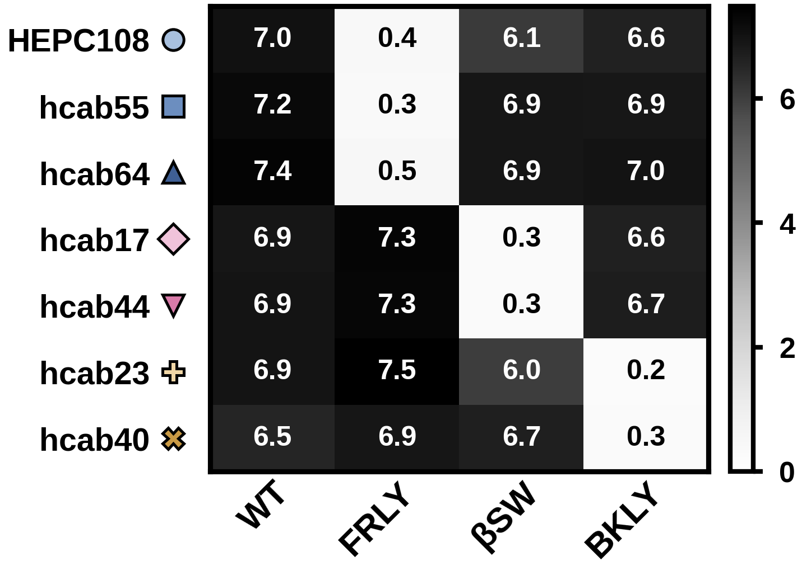

# Restraint-guided prediction of HCV E2-antibody complex structures using Chai-1

## Overview

Several experimental methods report coarse information about an
antibody-antigen complex without resolving its structure. Binding
against a panel of antigen variants can identify the antigenic region an
antibody targets, and competition assays can show that an antibody
shares an epitope with another antibody whose structure is already
known. Such data are far cheaper to obtain than a crystal or cryo-EM
structure and are available for many more antibodies. Current structure-
prediction methods are considerably less accurate for antibody–antigen
complexes than for protein–protein complexes in general, and their
accuracy improves substantially when the epitope is specified. Coarse
experimental information of this kind is therefore a potentially useful
input to prediction.

This repository applies that idea to hepatitis C virus E2. We use
epitope-knockout (Eko) E2 reagents, in which a defined antigenic region
is disrupted so that antibodies targeting that region lose binding while
antibodies targeting other regions are unaffected. Testing an antibody
against the panel identifies the antigenic region it targets. We
translate that assignment into distance restraints, derived from the
epitopes of known E2–antibody complexes within the same region, supply
them to Chai-1, and assess how far the restraints improve prediction
accuracy relative to unrestrained Chai-1 and to AlphaFold3.


## Quick start

```bash
conda env create -f environment.yml
conda activate ekochai
jupyter lab
```


| Notebook | What it does |
|---|---|
| `demo_hcab44/01_hcab44_end_to_end.ipynb` | one antibody, start to finish: epitope &rarr; restraints &rarr; prediction &rarr; scoring &rarr; DockQ and CDR RMSD |
| `figures/02_figure5_panels.ipynb` | panels B, C, D and G of the paper, rendered inline |

---

## Repository details

```
ekochai/            the method, as importable modules
  config.py         every constant that defines it
  restraints.py     reference complex -> Chai-1 pocket restraints
  predict.py        wrapper over chai_lab.chai1.run_inference (requires GPU)
  scoring.py        ipTM for a two-chain antibody, and model selection
  structures.py     Chai-1 CIF -> the two-chain PDB DockQ is run on
  dockq.py          DockQ against the experimental complex
  cdr.py            IMGT CDR-loop Ca RMSD
  files.py          read .pdb/.cif 

data/
  reference_structures/   42 aligned E2-antibody complexes (.pdb.gz) + a table
  experimental/           7 experimental complexes, two-chain form, for DockQ
  experimental_3chain/    three-chain form (.pdb.gz), for CDR RMSD
  sequences/              Chai-1 input FASTAs (antigen + heavy + light)
  summary/                summary of results

demo_hcab44/        the worked example, with the Chai-1 models it reads
figures/            panel code and the shared style module
af3/                how AlphaFold 3 was run, for the comparison
final_models/       the published predicted complexes, Chai-1r and AF3
docs/               figures used by this README
```
---

## The method

### 1. Definition of epitope residues

An antigen residue belongs to a reference epitope if any of its C&alpha; lies
within **8 &Aring;** of an antibody C&alpha; in the aligned reference complex.


### 2. A restraint says how close the antibody must come

Each contact becomes one Chai-1 `pocket` restraint with
`max_distance_angstrom` set to the **restraint cutoff** &mdash; swept over
8, 12, 16, 20 and 24 &Aring;.

The optimal cutoff is **16 &Aring;**.

### 3. For each query antibody, we scanned every epitope defined by a previously determined E2–antibody complex within the same antigenic region.

| mAb | antigenic region | epitopes scanned | own structure (excluded) |
|---|---|---|---|
| HEPC108 | FRLY | 27 | hepc108_A_H_L |
| hcab55 | FRLY | 26 | 8w0v_C_H_L |
| hcab64 | FRLY | 26 | 8w0w_C_H_L |
| hcab17 | BSW | 5 | 8w0y_C_H_L |
| hcab44 | BSW | 6 | — |
| hcab23 | BKLY | 7 | — |
| hcab40 | BKLY | 6 | 8w0x_C_H_L |


### 4. ipTM score (wipTM)

Contact-weighted ipTM score. sAB is the mean ipTM between chains A and B,
taken over both directions, and wAB the number of C-alpha contacts within
8 A across that interface.

```
sAB = (A->B + B->A)/2     antigen-heavy        wAB = contacts within 8 A
sAC = (A->C + C->A)/2     antigen-light        wAC = contacts within 8 A
wiPTM = (wAB*sAB + wAC*sAC) / (wAB + wAC)
```

---

## How the antigenic regions were assigned

Each mAb is knocked out by exactly one Eko probe. This is published panel 5A,
reproduced here as the input to everything above.



A probe that abolishes binding identifies that mAb's antigenic region, and the
region selects the reference epitopes in step 3.

---


---

## Contact

Rajat Punia, Cornell University &mdash; rp693@cornell.edu

Questions about the code are best raised as a GitHub issue.
